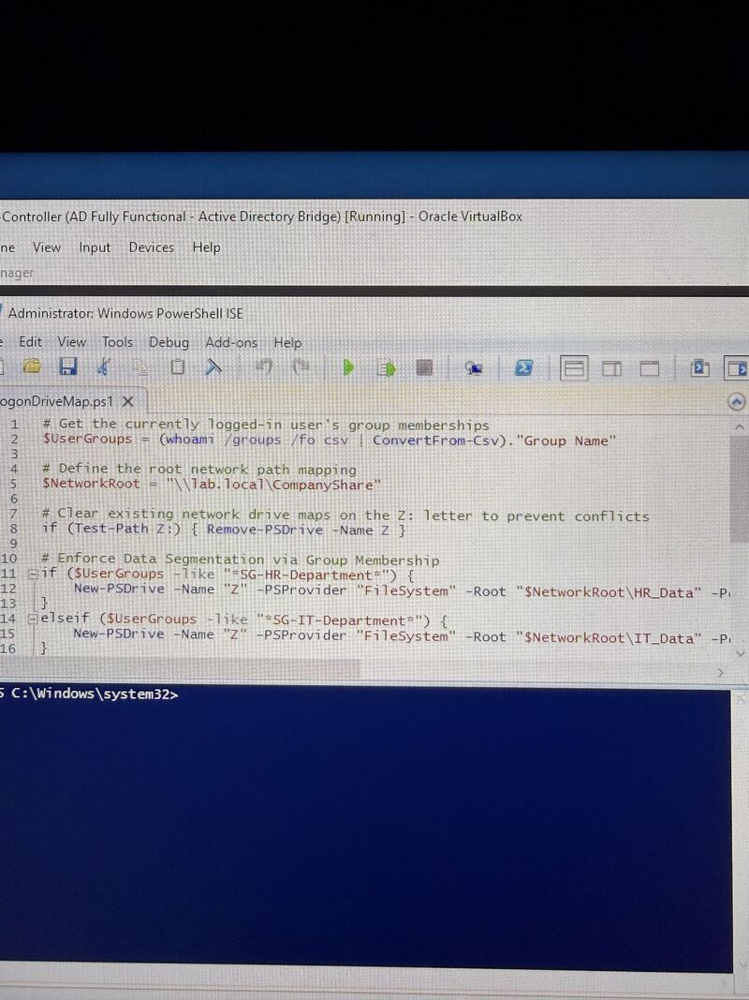
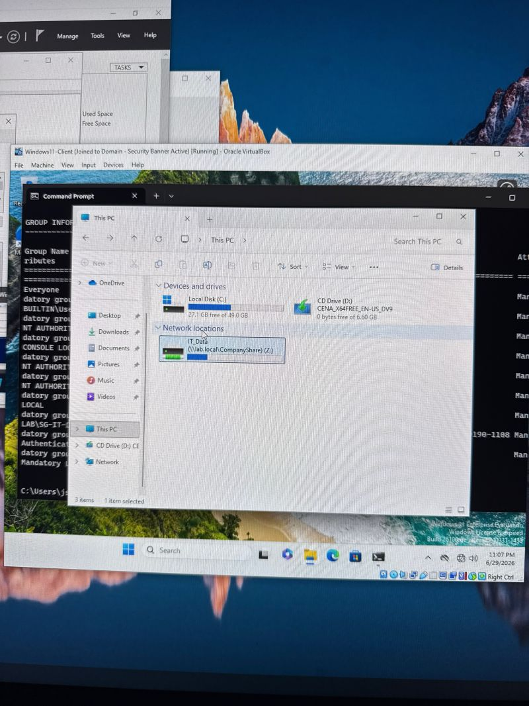
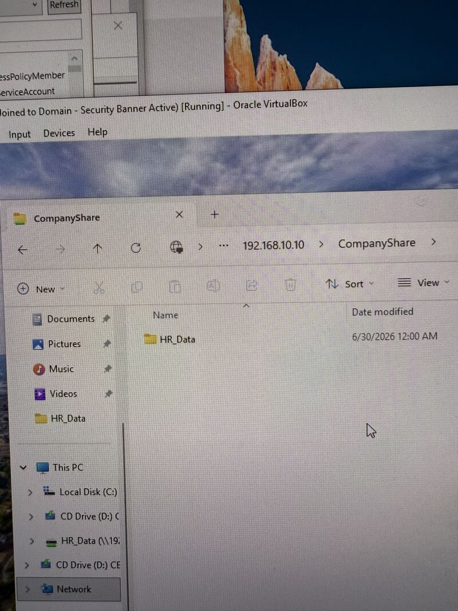
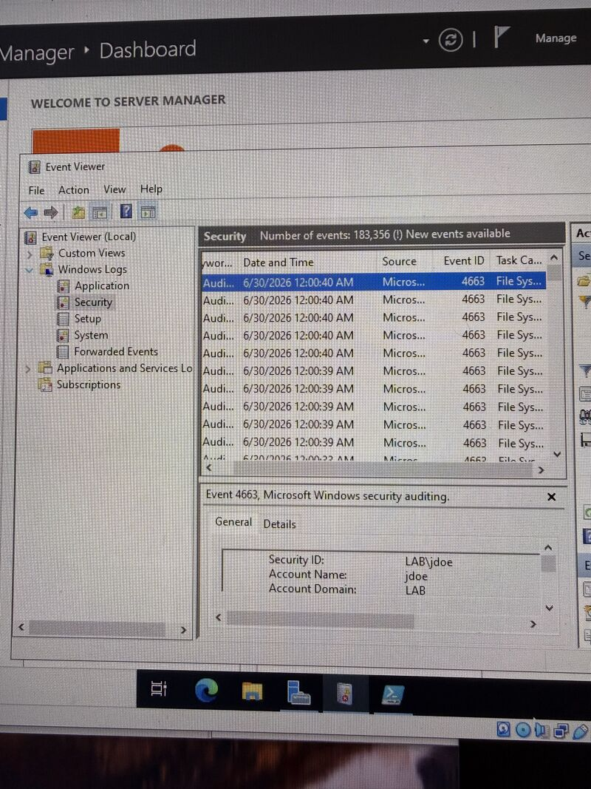

# Enterprise Active Directory Lab: Automated Drive Mapping, RBAC Data Segmentation, and Object Auditing

## 1. Project Overview
This project simulates an enterprise-level identity management, storage segmentation, and security auditing architecture within a virtualized sandbox. Using Windows Server as an Active Directory Domain Controller and a Windows 11 Enterprise client, this build automates user storage provisioning via PowerShell and Group Policy, enforces data privacy through Access-Based Enumeration (ABE), and implements centralized compliance auditing via Windows Security Event logging.

---

## 2. Architecture & Topology
* **Domain Controller:** Windows Server (`lab.local`, `192.168.10.10`)
  * Core Services: Active Directory Domain Services (AD DS), DNS, File and Storage Services
  * Roles Configured: SMB File Server, Central Group Policy Management
* **Client Endpoint:** Windows 11 Enterprise (Domain-Joined)
* **Virtualization Layer:** Oracle VirtualBox running on an internal virtual network bridge
* **Central File Share:** `\\lab.local\CompanyShare` (Local Server Path: `C:\CompanyShare`)

---

## 3. Directory Structure & Identity Management
An Organizational Unit (OU) and Role-Based Access Control (RBAC) hierarchy was established to mirror an enterprise department structure:

```text
lab.local
└── Employees (OU)
    ├── IT-Department (OU)
    │   ├── User: John Smith (jsmith)
    │   └── Security Group: SG-IT-Department
    └── HR Department (OU)
        ├── User: Jane Doe (jdoe)
        └── Security Group: SG-HR-Department
'''
---

## 4. Automation & Logon Script Architecture
Rather than manually mapping drives across individual endpoints, drive mounting was automated using a dynamic PowerShell logon script deployed through Group Policy Objects (GPOs)[cite: 5, 45].

### Dynamic Mapping Logic (`LogonDriveMap.ps1`)

The script evaluates the authenticated user's Kerberos token at logon, identifies departmental group membership, clears conflicting drive letters, and assigns persistent SMB mappings[cite: 7, 18, 45]:

```powershell
# Get the currently logged-in user's group memberships
$UserGroups = (whoami /groups /fo csv | ConvertFrom-Csv)."Group Name"

# Define the root network path mapping
$NetworkRoot = "\\lab.local\CompanyShare"

# Clear existing network drive maps on the Z: letter to prevent conflicts
if (Test-Path Z:) { Remove-PSDrive -Name Z }

# Enforce Data Segmentation via Group Membership
if ($UserGroups -like "*SG-HR-Department*") {
    New-PSDrive -Name "Z" -PSProvider "FileSystem" -Root "$NetworkRoot\HR_Data" -Persist
}
elseif ($UserGroups -like "*SG-IT-Department*") {
    New-PSDrive -Name "Z" -PSProvider "FileSystem" -Root "$NetworkRoot\IT_Data" -Persist
### Group Policy Deployment
1. Placed the script within the domain SYSVOL share: `\\lab.local\sysvol\lab.local\scripts\LogonDriveMap.ps1`.
2. Linked the GPO to the parent `Employees` OU to apply across all departmental containers.
3. Configured the logon script parameters under **User Configuration > Policies > Windows Settings > Scripts (Logon/Logoff) > Logon**:
   * **Script Name:** `LogonDriveMap.ps1`
   * **Script Parameters:** `-ExecutionPolicy Bypass`


*Figure 2: Automated network drive mapping (Z:) successfully verified on the Windows 11 client machine.*
## 5. Security Hardening & Access-Based Enumeration (ABE)

### Permission Hierarchy (NTFS vs. Share)
To enforce the principle of least privilege, folder inheritance was disabled on department subdirectories to prevent permission bleeding from the parent root[cite: 20, 32]:

| Object | Principal | Permissions (NTFS) | Applies To |
| :--- | :--- | :--- | :--- |
| `C:\CompanyShare` | `Domain Users` | Read & execute, List folder contents, Read | This folder only[cite: 22] |
| `C:\CompanyShare` | `Everyone` | Full Control / Change (Share Level) | Network Share[cite: 13, 21] |
| `C:\CompanyShare\IT_Data` | `SG-IT-Department` | Modify, Read & execute, List, Write | This folder, subfolders, and files[cite: 42] |
| `C:\CompanyShare\HR_Data` | `SG-HR-Department` | Modify, Read & execute, List, Write | This folder, subfolders, and files[cite: 18, 32] |

### Access-Based Enumeration Configuration
ABE was enabled on the `CompanyShare` SMB share via Server Manager. When users browse the root share directly:
* Windows evaluates the requesting user's security token against subfolder Access Control Lists (ACLs)[cite: 26].
* Folders for which the user lacks explicit Read/List permissions (such as `HR_Data` for an IT user) are dynamically hidden from directory enumeration rather than simply returning an "Access Denied" error[cite: 31, 33, 40].


*Figure 3: Client view of \\192.168.10.10\CompanyShare showing ABE dynamically hiding the HR_Data folder.*
## 6. Advanced Object Access Auditing & Compliance
To maintain an immutable security trail of file modifications, creations, and deletion attempts:

1. **GPO Configuration:** Configured under **Default Domain Controllers Policy**[cite: 19]:
   * `Computer Configuration > Policies > Windows Settings > Security Settings > Advanced Audit Policy Configuration > Audit Policies > Object Access > Audit File System`
   * Enabled: **Success** and **Failure**
2. **System Access Control List (SACL):** Added an Auditing entry on `C:\CompanyShare` targeting `Everyone`:
   * Monitored actions: `Create files / write data`, `Create folders / append data`, `Delete subfolders and files`, `Delete`[cite: 38]
   * Scope: `This folder, subfolders and files`[cite: 38]
3. **Log Verification:** 
   * Validated security logging in **Event Viewer > Windows Logs > Security**[cite: 44].
   * Inspected **Event ID 4663** ("An attempt was made to access an object"), recording exact security identifiers (SIDs), account names, source processes, and accessed target paths[cite: 44].


*Figure 4: Windows Event Viewer logging Event ID 4663 for granular file and directory access monitoring.*
## 7. Key Engineering & Troubleshooting Takeaways
* **Token Caching & Session Multiplexing:** Active Directory security group updates do not dynamically update active user sessions[cite: 29]. Tested Kerberos ticket updates via client reboot and validated token population using `whoami /groups`[cite: 29].
* **Parent Traversal Scoping:** Setting parent read permissions to `This folder, subfolders and files` exposed unintended directories across departmental boundaries[cite: 24, 34]. Scoping the traversal entry strictly to `This folder only` resolved the leak while preserving ABE filtering[cite: 25, 36].
* **Execution Boundary Resolution:** Overcame PowerShell ISE parsing differences and syntax exceptions by transitioning identity queries from legacy ADSI type lookups to CSV-parsed `whoami` objects[cite: 17, 18, 45].
